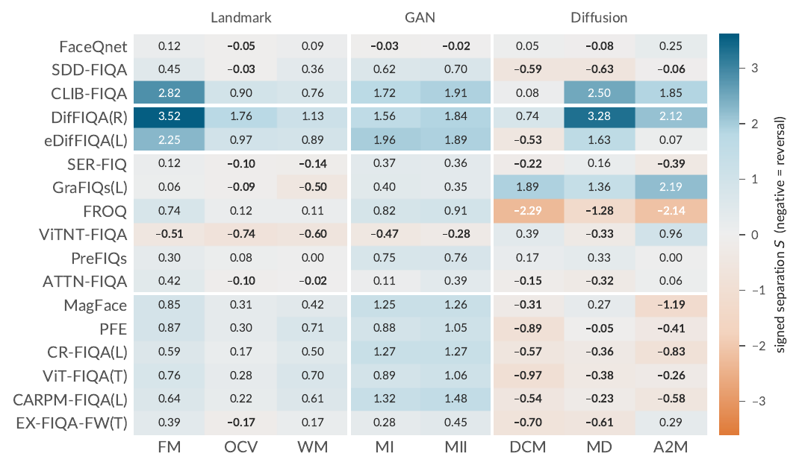
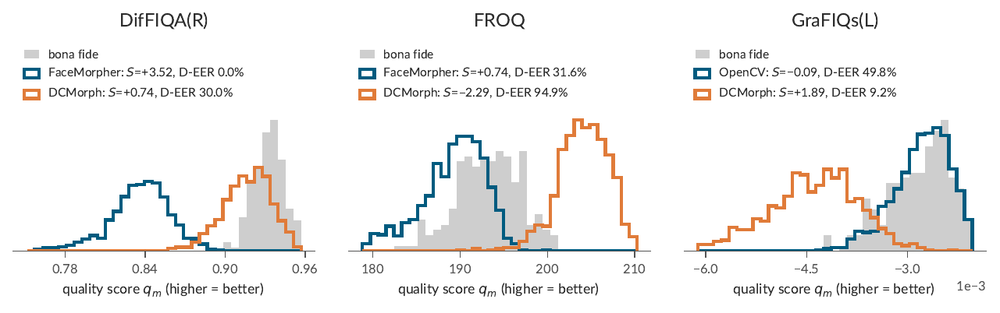

# FIQA-as-MAD: When Morphs Look Better

This repository contains the official implementation of the paper **"When Morphs Look Better: Face Image Quality as a Training-Free Signal for Morphing Attack Detection"**, accepted at BIOSIG 2026.

## Overview

Face image quality assessment (FIQA) estimates the utility of a face image for face recognition and is trained without morphs. We evaluate **17 FIQA methods** from all current FIQA categories as training-free single-image morphing attack detection (MAD) scores on **20 morphing attack sets** from two datasets, FRLL and FEI, including five diffusion-based attack sets.

- Each quality score is used directly as the MAD decision score. Only a threshold is set, on bona fide images.
- The score direction of each method is **fixed in advance** from its definition and never chosen per attack, so that cases in which morphs receive higher quality than bona fide images remain visible.
- A **signed separation** $S$ reports both the strength and the direction of the score shift caused by morphing.

<p align="center">
    
    <br>
    <em>Figure 1: Signed separation S of all methods on the FRLL attacks. Orange: reversal, i.e. morphs receive higher quality than bona fide images.</em>
</p>

<p align="center">
    
    <br>
    <em>Figure 2: A strong separation does not imply good detection. FROQ separates DCMorph strongly, but in the reversed direction.</em>
</p>

## Repository structure

```
evaluate.py              computes all results of the paper from a score table
fiqa_as_mad/             methods (fixed score directions), data loading, metrics (D-EER, MACER, BSCER, S, bootstrap)
data/scores.csv.gz       native scores of the 17 FIQA methods and of SelfMAD++ on all evaluated images
data/fiqa_pauc.csv       FIQA performance (pAUC of the error-versus-discard curve) of 14 methods
scoring/align.py         112x112 alignment (MTCNN, ArcFace template)
scoring/adapters.py      thin adapters that run the official implementation of each FIQA method
scoring/score.py         scores the evaluated images with one method
scoring/merge.py         combines rescored methods with the released scores
```

No code of the evaluated methods is redistributed. The adapters import the model code from the official repositories, which you clone yourself (see [Rescoring](#rescoring-the-images)).

## Reproducing the results

```
pip install -r requirements.txt
python evaluate.py
```

This reads `data/scores.csv.gz` and `data/fiqa_pauc.csv` and writes the following files to `results/`. Values are written with six decimals, so round them once for reporting.

| File | Content |
|---|---|
| `table_frll.csv`, `table_fei.csv` | D-EER and signed separation $S$ per attack, mean D-EER, mean MACER |
| `macer_per_attack_*.csv` | MACER per attack at BSCER = 20% |
| `confidence_intervals.csv` | 95% identity-level bootstrap intervals of the mean D-EER |
| `direction_selection.csv` | Mean D-EER with the direction selected using the attack labels (comparison only) |
| `threshold_transfer.csv` | Threshold set on one dataset, applied to the other |
| `fiqa_vs_mad_ranking.csv`, `fiqa_vs_mad_spearman.csv` | FIQA ranking vs. MAD ranking, Spearman correlation, leave-one-out |
| `per_attack_summary.csv` | Reversals, lowest D-EER, median D-EER per attack |

The bootstrap takes about two minutes. Use `--no-bootstrap` to skip it.

### Evaluation protocol

- **Score direction.** $q_m = \pi_m s_m$, with $\pi_m = -1$ for PFE, GraFIQs(L), PreFIQs, and SelfMAD++ (see `fiqa_as_mad/methods.py`). An image is classified as attack if $q_m \le \tau_m$.
- **D-EER.** The ROC point minimizing $|\mathrm{TPR}+\mathrm{FPR}-1|$ on the scikit-learn ROC, between the bona fide set and each attack set.
- **Threshold.** $\tau_m$ is the lowest bona fide score at which BSCER reaches 20% (41/204 on FRLL, 40/200 on FEI). It is applied unchanged to all attacks of the dataset, and MACER is reported at this threshold.
- **Signed separation.** $S = \mathrm{sign}(\mu_{BF}-\mu_A)\sqrt{\mathrm{FDR}}$.
- **Bootstrap.** 1,000 replicates over identities: a bona fide image is weighted by the draws of its identity, and a morph by the product of the draws of its two identities.

## Data

### Score table

`data/scores.csv.gz` has one row per evaluated image, identified by `dataset`, `subset`, and `image`. It has one column per method with the method's **native** score, i.e. the output of the official implementation, before the fixed direction $\pi_m$ is applied.

- **PreFIQs** stores the pruning drift.
- **PFE** stores the sum of $\sigma^2$.
- **GraFIQs(L)** stores the gradient magnitude.
- **SelfMAD++** stores the morph probability.

The table contains the images that every method, including the reference detector SelfMAD++, could process. The face detector of SelfMAD++ finds no face in 10 FRLL Arc2Morph images and in 1 LADIMO-inspired image, so these images are excluded for all methods.

### FIQA performance

`data/fiqa_pauc.csv` holds the partial area under the error-versus-discard curve of 14 methods for six FR models, eight benchmarks (Adience, AgeDB-30, CFP-FP, LFW, CALFW, CPLFW, XQLFW, IJB-C), and two false match rates. The 64 combinations with results for all 14 methods (ArcFace, CurricularFace, ElasticFace, MagFace) define the FIQA ranking.

### Datasets

The images are not redistributed. To rescore them, obtain the following:

| Data | Source |
|---|---|
| FRLL bona fide images (204) and the MAD22 attacks FaceMorpher, OpenCV, WebMorph, MIPGAN-I, MIPGAN-II | [SYN-MAD 2022](https://github.com/marcohuber/SYN-MAD-2022), Face Research Lab London Set ([CC BY 4.0](https://doi.org/10.6084/m9.figshare.5047666)) |
| DCMorph on the MAD22 pairs | from the authors of DCMorph |
| MorDIFF on the MAD22 pairs | generated with [MorDIFF](https://github.com/naserdamer/MorDIFF), default settings |
| Arc2Morph on the MAD22 pairs | generated with [Arc2Morph](https://github.com/MI-BioLab/arc2morph), default settings |
| FEI-Morph V3 (200 bona fide images, 12 attack sets) | University of Bologna, license agreement required |

The pair of each morph is encoded in its file name in `data/scores.csv.gz`. Faces are aligned to 112x112 with

```
python scoring/align.py --in <images> --out <aligned> --align-repo <clone of https://github.com/gurayozgur/face_alignment>
```

Place the aligned images as `<root>/<dataset>/<subset>/<image>`, using the names of `data/scores.csv.gz` (e.g. `FRLL/MorDIFF/morph_001_03_and_010_03.png`).

## Rescoring the images

Clone the official repository of a method, download its weights as described there, and run

```
python scoring/score.py --method <method> --repo <clone> --weights <checkpoint> --images <root> --out scores/<method>.csv
python scoring/merge.py scores/*.csv --out my_scores.csv.gz
python evaluate.py --scores my_scores.csv.gz
```

`merge.py` takes the methods you did not rescore from the released table. `--limit N` scores only the first N images of each subset, as a quick check.

| `--method` | Repository | Weights (`--weights`) | Framework |
|---|---|---|---|
| `faceqnet` | [FaceQnet](https://github.com/uam-biometrics/FaceQnet) | `FaceQnet_v1.h5` | TensorFlow 2 (Keras 2) |
| `sdd_fiqa` | [TFace](https://github.com/Tencent/TFace) (`quality/`) | `SDD_FIQA_checkpoints_r50.pth` | PyTorch |
| `clib_fiqa` | [CLIB-FIQA](https://github.com/oufuzhao/CLIB-FIQA) | `CLIB-FIQA_R50.pth`, plus `--clip-rn50 RN50.pt` (OpenAI CLIP) | PyTorch |
| `diffiqa_r` | [DifFIQA](https://github.com/LSIbabnikz/DifFIQA) | `diffiqa(r).pth` | PyTorch |
| `ediffiqa_l` | [eDifFIQA](https://github.com/LSIbabnikz/eDifFIQA) | `ediffiqaL.pth` | PyTorch |
| `ser_fiq` | [SER-FIQ](https://github.com/pterhoer/FaceImageQuality) | insightface model of the repository | MXNet |
| `grafiqs_l` | [GraFIQs](https://github.com/jankolf/GraFIQs) | `resnet100_ms1mv2_arcface.pth` | PyTorch |
| `froq` | [FROQ](https://github.com/LSIbabnikz/FROQ) | AdaFace model of the repository, and `observer/observer_data.pkl` created with the repository's `observer/initialization.py` | PyTorch |
| `vitnt_fiqa` | [ViTNT-FIQA](https://github.com/gurayozgur/ViTNT-FIQA) | `minchul_cvlface_adaface_vit_base_webface4m.pt` | PyTorch |
| `prefiqs` | [GraFIQs](https://github.com/jankolf/GraFIQs) (iResNet code) | `resnet100_ms1mv2_arcface.pth` | PyTorch |
| `attn_fiqa` | [ATTN-FIQA](https://github.com/gurayozgur/ATTN-FIQA) | `vits_wf4m_adaface.pt` | PyTorch |
| `magface` | [MagFace](https://github.com/IrvingMeng/MagFace) | `magface_epoch_00025.pth` | PyTorch |
| `pfe` | [PFE](https://github.com/seasonSH/Probabilistic-Face-Embeddings) | folder `PFE_sphere64_msarcface_am` | TensorFlow 2 (v1 compat) |
| `cr_fiqa_l` | [CR-FIQA](https://github.com/fdbtrs/CR-FIQA) | `181952backbone.pth` (CR-FIQA(L)) | PyTorch |
| `vit_fiqa_t` | [ViT-FIQA](https://github.com/atzoriandrea/ViT-FIQA-Assessing-Face-Image-Quality-using-Vision-Transformers) | quality-token checkpoint | PyTorch |
| `carpm_fiqa_l` | [CARPM-FIQA](https://github.com/gurayozgur/CARPM-FIQA) | `CARPM-FIQA(L).pth` | PyTorch |
| `ex_fiqa_fw_t` | [EX-FIQA](https://github.com/gurayozgur/EX-FIQA) | ViT-FIQA(T) quality-token checkpoint | PyTorch |

All adapters read the aligned images with OpenCV and convert them to RGB. The method-specific preprocessing follows the official implementations and is documented in `scoring/adapters.py`. Install the requirements of each repository. SER-FIQ needs MXNet (`--gpu -1` runs it on the CPU), and FaceQnet and PFE need TensorFlow. SER-FIQ is stochastic (100 dropout passes per image), so repeated runs differ slightly.

### SelfMAD++ (reference only)

The SelfMAD++ scores were computed with the [official implementation](https://github.com/LeonTodorov/SelfMADpp) and released weights on the same aligned images, using the authors' face crop, which upsamples them to its 512x512 input. SelfMAD++ is listed for reference only and is not compared with the FIQA methods.

## Citation

```
@inproceedings{FIQAasMAD2026,
  author    = {Hao Peng and Fu Bo and Mahmoud Elshirbeny and Guray Ozgur},
  title     = {When Morphs Look Better: Face Image Quality as a Training-Free Signal for Morphing Attack Detection},
  booktitle = {International Conference of the Biometrics Special Interest Group, {BIOSIG} 2026},
  year      = {2026}
}
```

## Acknowledgment

This research work has been funded by the German Federal Ministry of Education and Research and the Hessen State Ministry for Higher Education, Research and the Arts within their joint support of the National Research Center for Applied Cybersecurity ATHENE.

## License

>This project is licensed under the terms of the **Attribution-NonCommercial-ShareAlike 4.0 International (CC BY-NC-SA 4.0)** license.
Copyright (c) 2026 Fraunhofer Institute for Computer Graphics Research IGD Darmstadt
For more details, please take a look at the [LICENSE](./LICENSE) file.
